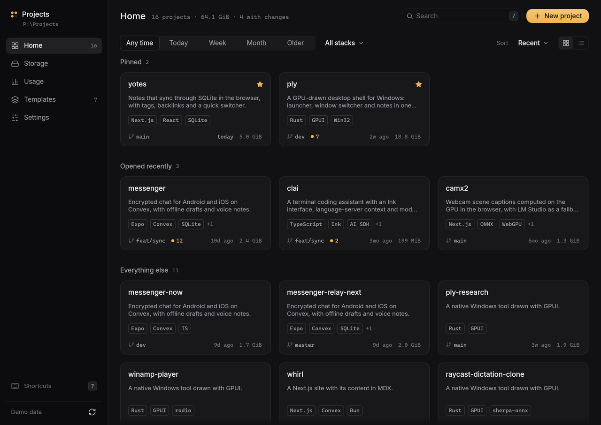
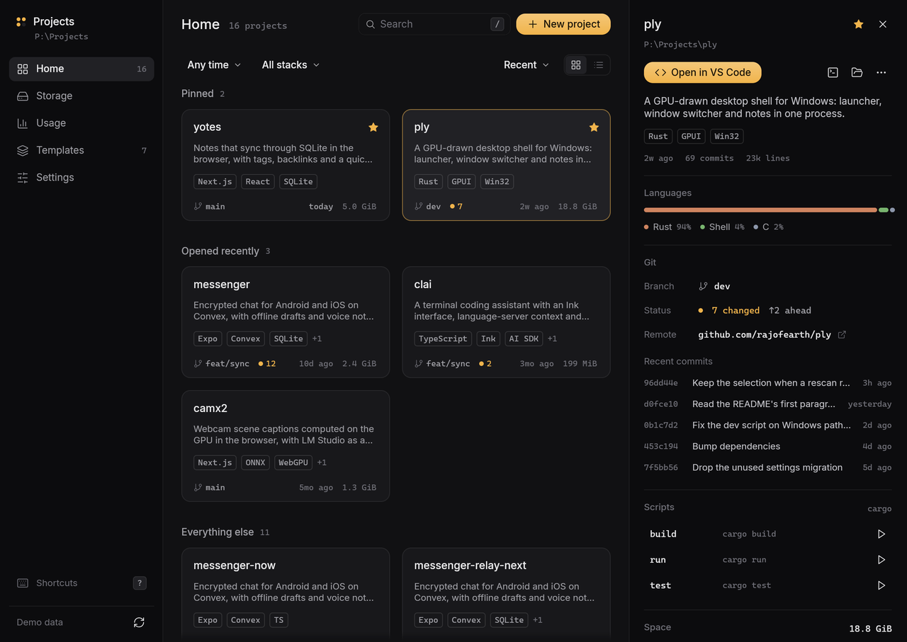
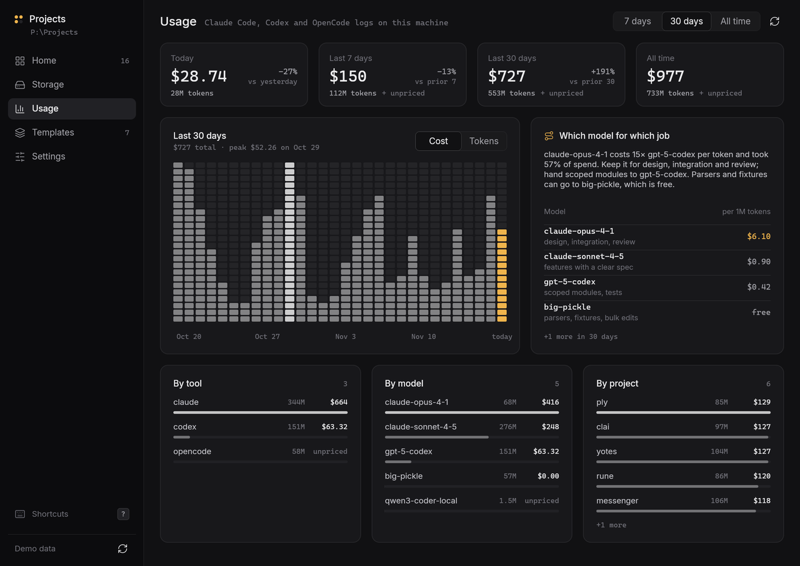
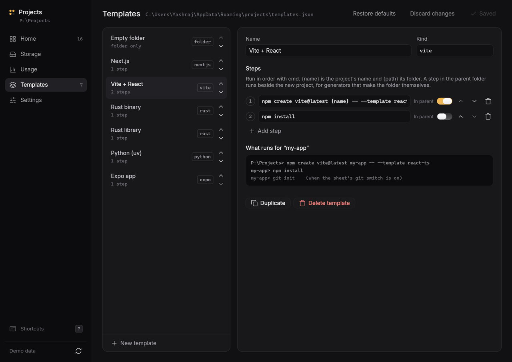
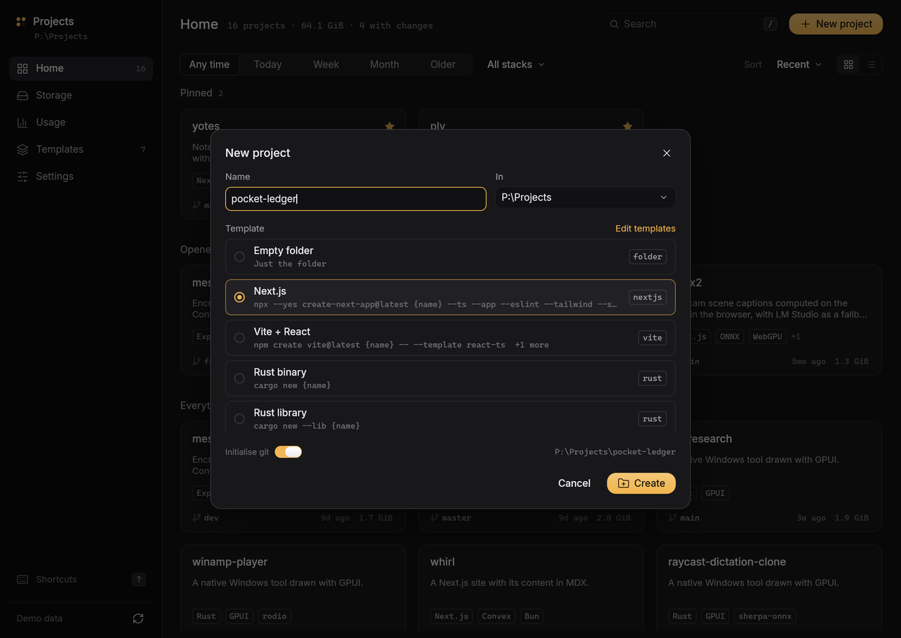
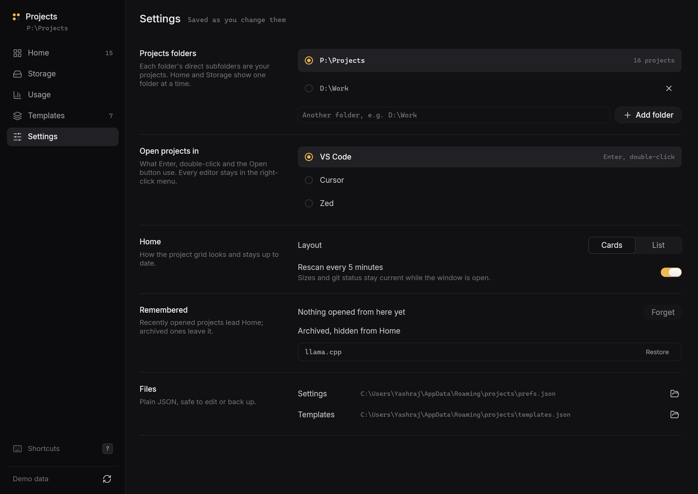
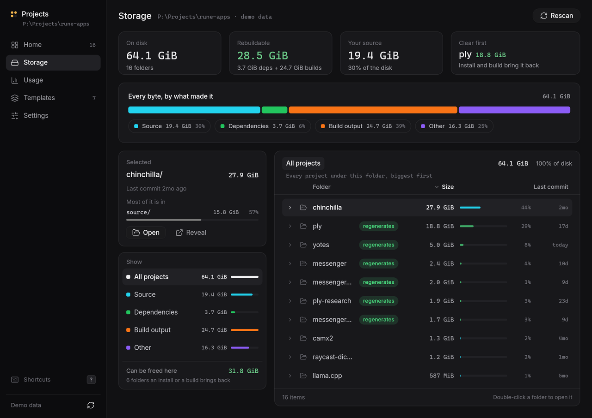

<p align="center">
  
</p>

# Projects

A Windows desktop project manager built with [Rune](https://github.com/anomalyco/rune).

## Screenshots

<table>
  <tr>
    <td width="50%" valign="top"><br><sub>Home: every project under the root folder, with search, filters and sorting</sub></td>
    <td width="50%" valign="top"><br><sub>Project detail: git state, languages, scripts and disk use</sub></td>
  </tr>
  <tr>
    <td width="50%" valign="top"><br><sub>Usage: AI coding-agent tokens and estimated cost</sub></td>
    <td width="50%" valign="top"><br><sub>Templates: the new-project recipes, editable in the app</sub></td>
  </tr>
  <tr>
    <td width="50%" valign="top"><br><sub>New project: pick a template and stream the command output</sub></td>
    <td width="50%" valign="top"><br><sub>Settings: projects folder, editor, layout and rescans</sub></td>
  </tr>
  <!--
  <tr>
    <td width="50%" valign="top"><br><sub>Storage: disk use by category, with reclaimable space</sub></td>
    <td width="50%" valign="top"></td>
  </tr>
  -->
</table>

## Features

- Home: browse every project under the root folder as cards or a dense list. Search by name, stack or description, filter by how recently a project was worked on or by stack, sort by recent activity, name or size. Pin projects to the top, archive the ones you do not want to see, and keep a card detail panel beside the grid.
- Project detail: description and stack tags, commit and line counts, language mix, git state (branch, dirty files, ahead/behind, remote and recent commits), runnable scripts from the project manifest, and a disk-space breakdown. Double-click a card or press Enter to open the folder in your editor; right-click for a menu with open-in-editor, terminal, run script, reveal in Explorer, copy path, show in storage, pin and archive.
- New project: create a folder from an editable template, optionally with `git init`, while streaming the command output.
- Storage: disk usage across the projects folder, broken down by category (source, dependencies, build output and other). Walk into folders to find what is taking space, with reclaimable space called out and the biggest rebuildable folder surfaced.
- Usage: AI coding-agent token usage and estimated cost from local Claude Code, Codex and OpenCode logs, grouped by provider, model, day and project.
- Templates: add, edit and remove the new-project templates stored on disk.
- Settings: choose the projects folder, the default editor, the page layout and order, and whether the folder is rescanned automatically (every five minutes).
- State such as pins, archives, recently opened projects, layout, folders and editor survives restarts, stored in a Rune preferences file.

## Keyboard shortcuts

- Ctrl+1 through Ctrl+5: go to Home, Storage, Usage, Templates, Settings
- `/` or Ctrl+F: search projects
- Ctrl+N: new project
- Ctrl+R: rescan the projects folder
- Arrow keys: move between projects
- Enter: open the selected project in your editor
- Space: show or hide details
- P: pin or unpin
- T: open a terminal in the project
- Esc: close a dialog or menu, or clear the search
- `?`: show the full shortcut sheet in the app

## Install

Download `projects-windows-x64.exe` from the [latest release](https://github.com/rajofearth/projects/releases/latest/download/projects-windows-x64.exe) and open it. The install window asks for a folder (by default `%LOCALAPPDATA%\Programs\Projects`), copies the exe there, adds a Start menu shortcut and an entry under Settings, Apps, then opens the installed copy. It installs for your account only, so it needs no admin rights. Folders under Program Files or Windows are refused for that reason. A folder that already holds other files gets a `Projects` folder inside it.

The exe is not Authenticode-signed, so Windows SmartScreen warns the first time it runs. Choose More info, then Run anyway.

"Run without installing" opens the downloaded copy once, with updates off.

To uninstall, use Settings, Apps, Projects. That removes the exe, the shortcut and downloaded updates. Settings and templates in `%APPDATA%\projects` stay, so a reinstall picks them up.

## Updates

An installed copy checks the repository's latest GitHub release six seconds after it opens and every four hours after that. A newer version downloads in the background to `%LOCALAPPDATA%\Projects\updates`. The sidebar then shows the version and a Restart button, and Settings, Updates lists what changed. If you close Projects instead of restarting, the update installs the next time Projects opens, before its window appears.

Each release carries `projects-windows-x64.exe.sig`: the version, the exe's SHA-256, and an Ed25519 signature over both. The app checks the signature against the public key compiled into it (`src/update/verify.rs`) before it downloads the exe, checks the downloaded bytes against the SHA-256, and checks both again just before installing. A release whose files were swapped, or an older signed exe relabelled as a newer version, is refused.

Installing renames the running exe to `Projects.exe.old`, moves the new one into its place and starts it, while the old exe waits for the new one to finish starting. If the new version exits before then, the old exe moves back and starts again, and that version is skipped until a newer one is released.

Updates are off for debug builds, builds run from a `target` folder, command-line runs such as `--scene`, and any run with `PROJECTS_PORTABLE` set. Automatic downloads can be turned off in Settings, Updates; Check now still works.

## Build and run

```sh
cargo run --release
```

The app scans the root folder on startup and fills in projects as they finish. Use `--scene demo` for built-in sample data with no disk scan, `--scene demo-update` for the update controls, and `PROJECTS_SHOW_INSTALLER=1` with `--scene setup` (or `setup-working`, `setup-existing`, `setup-error`) for the install window.

Set `RUNE_STATS_ROOT` to point at a different projects folder for a run; it defaults to `P:\Projects`.

### Releasing a version

The version lives in `version` under `[package]` in `Cargo.toml`. To cut a release, bump it, commit, then tag and push the tag:

```sh
# edit version = "X.Y.Z" in Cargo.toml, commit it, then:
git tag vX.Y.Z && git push --tags
```

Pushing a `v*` tag runs `.github/workflows/release.yml`. It fails if the tag doesn't match `Cargo.toml`, builds the release exe, signs it with the `RELEASE_SIGNING_KEY` repository secret, checks the signature against the key compiled into the app, and publishes `projects-windows-x64.exe` and its `.sig` with notes generated from the merged PRs since the previous tag (grouped by label, as set in `.github/release.yml`). The workflow can also be started by hand from the Actions tab.

The updater reads releases without signing in to GitHub, so it only finds them while the repository is public.

### The signing key

`cargo run --bin release-sign -- keygen` prints a new key pair. The public half goes in `PUBLIC_KEY` in `src/update/verify.rs`. The secret half goes in the `RELEASE_SIGNING_KEY` secret and never in the repository. Copies built with an old key reject releases signed with a new one, so after replacing the key, users download the next version by hand.

## Templates

Templates live in `%APPDATA%\projects\templates.json` (or under `%USERPROFILE%` when `APPDATA` is not set). The file is a JSON array. On first run, if the file is missing or invalid, the built-in defaults are written out.

Each template has an `id`, a display `name`, a short `kind` label, and a list of `steps`. A step has a `run` command executed through `cmd /C` and an `in_parent` flag: `true` runs the command in the parent folder, for generators that create the project folder themselves; `false` runs it inside the new folder. The placeholders `{name}` (project name) and `{path}` (absolute project path) are substituted in commands.

Example:

```json
[
  {
    "id": "empty-folder",
    "name": "Empty folder",
    "kind": "folder",
    "steps": []
  },
  {
    "id": "rust-bin",
    "name": "Rust binary",
    "kind": "rust",
    "steps": [
      {
        "run": "cargo new {name}",
        "in_parent": true
      }
    ]
  },
  {
    "id": "vite-react",
    "name": "Vite + React",
    "kind": "vite",
    "steps": [
      {
        "run": "npm create vite@latest {name} -- --template react-ts",
        "in_parent": true
      },
      {
        "run": "npm install",
        "in_parent": false
      }
    ]
  }
]
```

You can edit this file by hand or use the Templates page in the app.

## Where data comes from

- Projects, disk usage, languages, scripts, git facts and commits: read from the folders under the root. The scanner walks each project in parallel, buckets disk space into source, dependencies, build output and other, counts code lines by file extension, and asks `git` for branch, history and working-tree state. Project descriptions and stack labels come from manifests and README files.
- Usage: parsed from local log files. Claude Code from `%USERPROFILE%\.claude\projects\**\*.jsonl`, Codex from `%USERPROFILE%\.codex\sessions\**\*.jsonl`, and OpenCode from `%USERPROFILE%\.local\share\opencode\storage\message\**\*.json`. Cost uses the value in the log when present, otherwise a built-in list-price table; unknown models are counted as zero cost and flagged as unpriced.
- Settings and pins: a Rune preferences file named `projects`, written whenever something changes.
- Templates: `%APPDATA%\projects\templates.json`.

## Credits

- Built with [Rune](https://github.com/anomalyco/rune).
- Usage-page log-parsing and cost logic adapted from t3code.
